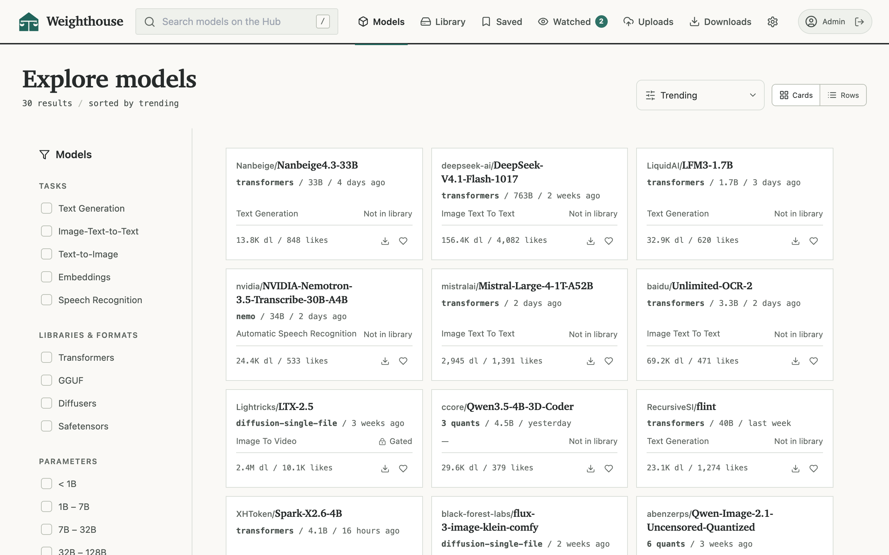

<p align="center">
  
</p>

<h1 align="center">Weighthouse</h1>

<p align="center">
  A self-hosted model library.<br>
  Download Hugging Face models onto your own storage, pin the revision you want, verify the copy, and keep an eye out for updates. Includes an MCP server and scoped keys for agentic use, and multiple locations and user accounts support enterprise deployments with tiered storage.
</p>



<table>
  <tr>
    <td width="50%" valign="top"><strong>Multi-user</strong><br>Roles, per-account libraries, notes, and preferences.</td>
    <td width="50%" valign="top"><strong>Shared notes</strong><br>Record your notes for each model; optionally share them with the team.</td>
  </tr>
  <tr>
    <td valign="top"><strong>Private uploads</strong><br>Upload your own weights, keep them private or choose to share them.</td>
    <td valign="top"><strong>Storage locations</strong><br>Move copies between cold, warm, and hot tiers on demand.</td>
  </tr>
  <tr>
    <td valign="top"><strong>Revision pinning</strong><br>Drift is reported, never automatically applied.</td>
    <td valign="top"><strong>Agentic control</strong><br>Scoped keys and a stable API for ops and locally proxied model research.</td>
  </tr>
  <tr>
    <td colspan="2" valign="top"><strong>One container</strong><br>Easy deployment with the provided Docker container.</td>
  </tr>
</table>

## Run it

Weighthouse ships as a container. You need Docker and two host directories to run it: one for model files, one for application state.

```bash
mkdir weighthouse && cd weighthouse
curl -O https://raw.githubusercontent.com/weighthouse/weighthouse/main/docker-compose.yml
curl -o .env https://raw.githubusercontent.com/weighthouse/weighthouse/main/.env.example
```

Edit `.env` — `MODEL_STORAGE_PATH` is the host directory that holds models — then:

```bash
docker compose up -d
```

Open port 7860. The first time you visit you'll be prompted to create the administrator account; you can add additional accounts from Settings.

Session cookies are marked Secure by default. If you're serving via plain HTTP, set "ALLOW_INSECURE_COOKIES=true" in your .env file.

Windows users can run it with Docker Desktop through the helpers in [deploy/desktop](deploy).

## Upgrading from ModelHarbor

All you need to do is pull the new Docker image. If you use the default SQLite database, then Weighthouse automatically copies your library database (modelharbor.sqlite3) to library.sqlite3 (in the same data directory). The original modelharbor.sqlite3 stays as a backup; feel free to delete it whenever you're ready. If you use Postgres, no changes are required.

## Documentation

| | |
|---|---|
| [Deployment](deploy/README.md) | How to deploy Weighthouse using Docker Compose, Docker Desktop, or compiling from source |
| [Storage](docs/storage.md) | The model folder, hand-added models (uploads), named locations, S3 storage, moving a host, backups |
| [Downloads](docs/downloads.md) | Download modes, gated models, watchlist and updates, GGUF inspection |
| [Accounts](docs/accounts.md) | Members, saved models and notes, local uploads |
| [PostgreSQL](docs/postgres.md) | Running the metadata database on PostgreSQL |
| [Agent API](docs/agent-api.md) | API keys and the MCP endpoint for local agents |
| [Development](docs/development.md) | Running from a source checkout, tests |

## What's new in 2.0.0

* Weighthouse — the project has a new name
* Library database moved to a neutral filename with automatic migration from modelharbor.sqlite3
* Comment and documentation cleanup, dependency upgrades, and a security sweep

## License

Weighthouse is released under the MIT License (see `LICENSE`). It is based on the open-source [HuggingHack](https://github.com/tyedalwaves/HuggingHack) project.

## AI assistance

toks.love developed Weighthouse with AI assistance. toks.love owns the code, as well as any mistakes or omissions.